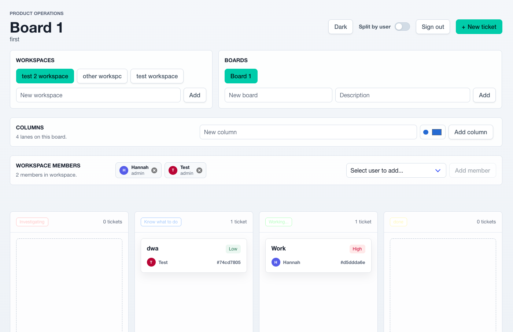

# Alpine

This is a kanban board issue tracker inspired by the commonly used enterprise versions (Jira, Linear, Asana, etc.). It contains one backend management service (complete with in-house user account management) and several frontend implementations that all work equally well depending on what vibe you want.

## Project Structure

- [**alpine-backend/**](alpine-backend): The main backend service in Java (Spring Boot).
- [**alpine-frontend-unadorned/**](alpine-frontend-unadorned): A serious, clean, and unadorned implementation of the frontend.
- [**alpine-frontend-playful/**](alpine-frontend-playful): A casual, silly implementation of the frontend.

## Visuals

### Unadorned Frontend

### Playful Frontend

## Getting Started

To run the full application locally, you must first start the backend service, then run one of the frontend applications.

### 1. Backend

The backend requires Docker for the database. Follow the [backend README](alpine-backend/README.md) to start PostgreSQL and the Spring Boot API.

### 2. Frontend

Once the backend is running, choose your preferred frontend implementation:

- **For the serious experience:** Follow instructions in [alpine-frontend-unadorned/README.md](alpine-frontend-unadorned/README.md).
- **For the playful experience:** Follow instructions in [alpine-frontend-playful/README.md](alpine-frontend-playful/README.md).
