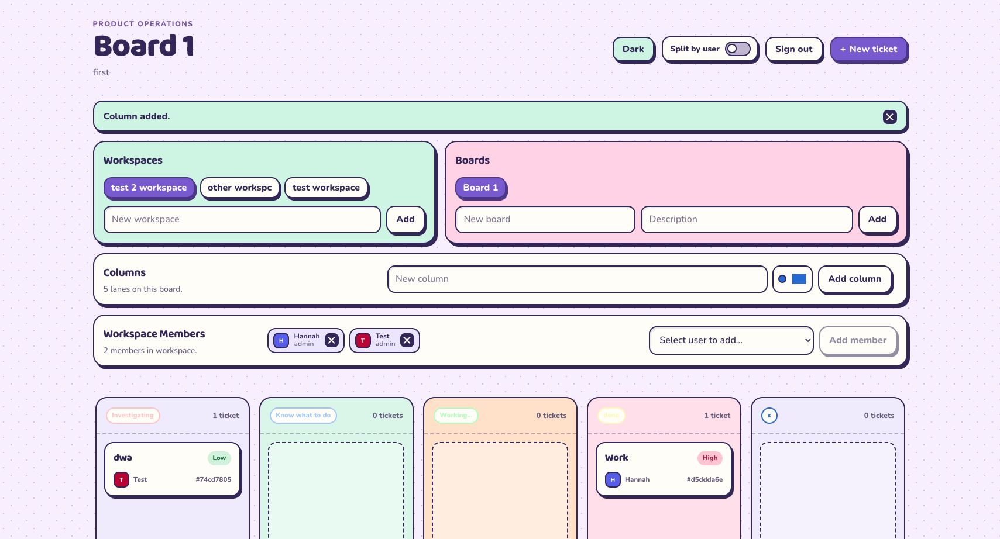

# Alpine Frontend

Alpine is a playful Kanban project-management frontend built with React, TypeScript, and Vite. It is designed to be used with the sibling [`alpine-backend`](../alpine-backend/) project, a Java/Spring Boot API that provides authentication, workspaces, boards, tickets, team members, labels, comments, and activity updates.



## Features

- Sign in and create an account with JWT authentication
- View and create workspaces and boards
- Manage board columns and ticket workflow states
- Create, edit, assign, label, and move tickets between columns
- Reorder tickets with drag-and-drop
- View and add ticket comments
- View board activity and manage workspace members
- Persist the selected workspace, board, and access token in browser storage

## Tech stack

- React 19
- TypeScript
- Vite
- Native `fetch` for API requests
- [Jelly UI](https://jelly-ui.com/) web components for form controls and buttons

## Prerequisites

- Node.js and npm
- Java 26
- Docker, for the local PostgreSQL database

The frontend expects the backend at `http://localhost:8080` by default. The frontend API contract is documented in [`openapi.yaml`](./openapi.yaml), and the backend has its own API definition in [`alpine-backend/openapi.yaml`](../alpine-backend/openapi.yaml).

## Run the backend

From the sibling backend directory:

```bash
cd ../alpine-backend
docker compose up -d
./gradlew bootRun
```

The first command starts PostgreSQL on `localhost:5432` with the default development database `alpine`. The Spring Boot server then starts on `http://localhost:8080`; Flyway applies the database migrations automatically.

The backend defaults are:

- Database: `jdbc:postgresql://localhost:5432/alpine`
- Database user/password: `postgres` / `postgres`
- API port: `8080`
- JWT secret: a development default; set `JWT_SECRET` to a secure value outside local development

To stop the database after development:

```bash
cd ../alpine-backend
docker compose down
```

## Run the frontend

From this frontend directory:

```bash
npm install
npm run dev
```

Open the URL printed by Vite, usually [http://localhost:5173](http://localhost:5173).

The complete local startup flow is therefore:

```bash
# Terminal 1: backend and PostgreSQL
cd ../alpine-backend
docker compose up -d
./gradlew bootRun

# Terminal 2: frontend
cd ../alpine-frontend-playful
npm install
npm run dev
```

To use a backend at another URL, create a `.env.local` file in the frontend project root:

```bash
VITE_API_URL=http://localhost:8080
```

`VITE_API_URL` is read at build time, so restart Vite after changing it.

## Frontend commands

| Command | Description |
| --- | --- |
| `npm run dev` | Start the Vite development server with hot module replacement |
| `npm run build` | Type-check and create a production build in `dist/` |
| `npm run preview` | Serve the production build locally |
| `npm run lint` | Run ESLint |

## Backend commands

Run these from `../alpine-backend`:

| Command | Description |
| --- | --- |
| `docker compose up -d` | Start the PostgreSQL development database |
| `./gradlew bootRun` | Start the Spring Boot API on port 8080 |
| `./gradlew test` | Run the backend test suite |
| `docker compose down` | Stop the PostgreSQL container |

## Getting started details

The frontend setup is:

1. Install dependencies with `npm install`.
2. Start the backend and PostgreSQL as described above.
3. Start Vite with `npm run dev`.
4. Register an account or sign in from the app.

## Project structure

```text
src/
├── App.tsx             Main application UI and board interactions
├── api.ts              Typed REST API client
├── types.ts            API and UI types
├── index.css           Global styles and fonts
├── App.css             Application styles
└── jelly-ui.d.ts       TypeScript declarations for Jelly UI elements
public/                 Static assets
openapi.yaml            Backend API contract
```

## API and authentication

The app calls the backend through the client in [`src/api.ts`](./src/api.ts). It supports the authentication and board endpoints defined in `openapi.yaml`, including:

- `POST /auth/login` and `POST /auth/register`
- `GET /auth/me`
- Workspace and board listing/creation
- `GET /boards/{boardId}/full`
- Ticket creation, editing, assignment, labeling, and movement
- Ticket comments and board activity

After login or registration, the returned access token is stored in `localStorage` and sent as a Bearer token on authenticated requests. If the backend is unavailable or the API returns an error, the message is shown in the application UI.

## Production build

Build the frontend with:

```bash
npm run build
```

The generated files are written to `dist/`. Before deploying, set `VITE_API_URL` to the publicly reachable Alpine API URL and rebuild the app.

